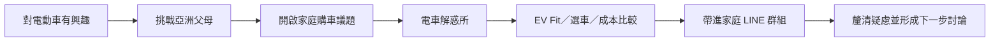
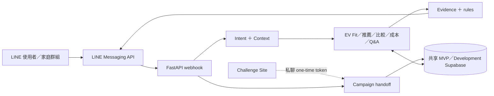

# ⚡ 電車解惑所

> **From EV curiosity to family consensus.**
>
> 從「我想買電動車」，一路陪使用者走到「我們家可以一起討論」。

**挑戰亞洲父母**：讓家庭購車議題有一個願意開始的入口。

**電車解惑所**：讓開始之後的每個疑問，都有辦法繼續談下去。

### 讓「要不要買電動車」從一場家庭爭論，變成可以一起討論的選擇。

「電車解惑所」是 2026 和泰 AI 黑客松的 LINE Bot 競賽 MVP，聚焦 TOYOTA 電動車決策情境。它協助使用者把充電、電池、續航、成本和車款選擇等疑慮，整理成可比較、可查證，也能帶進家庭討論的資訊。

> 2026 和泰 AI 黑客松 LINE Bot MVP｜競賽原型，非正式商用服務。

## 為什麼做「電車解惑所」？

對 EV 有興趣，未必代表家人已準備好一起換車；討論常圍繞充電、電池、長途、成本，以及「為什麼不直接買油電？」

問題不是資訊不存在，而是資訊散落、難比較，更難轉成：「我們家到底適不適合？」

## 我們的解法

### 01｜理解需求

接住自然語言提問與追問，延續當下的選車、成本或 EV 探索。

### 02｜轉成可比較資訊

用 EV Fit、車款比較、成本試算與官方資料，把疑慮整理成條件、差異和下一步。

### 03｜帶進家庭討論

在家庭 LINE 群組低干擾解惑，讓個人探索能延續為共同討論。

## 為什麼不是再做一個 EV Chatbot？

一般 Chatbot：**User ↔ Bot** → 電車解惑所：**User ↔ Family ↔ Bot**

- **member-isolated flow**：每位成員各自承接流程。
- **low-interference**：不把每句群組聊天都當成提問。
- **side query 與 conversation continuation**：回答短問句，並盡可能保留原流程。
- **concern board**：整理家庭共同待釐清議題。
- 不替家人貼上「支持／反對」標籤。

## 核心體驗

| 功能 | 使用者問題 | 系統如何協助 |
| --- | --- | --- |
| EV Fit | 我適合開電動車嗎？ | 依里程、長途、停車與充電條件整理適配因素。 |
| 車款推薦 | 我適合哪台 Toyota？ | 累積明確的預算、空間、用途與里程需求，依車款資料整理候選。 |
| 車款比較 | bZ4X 和 RAV4 怎麼選？ | 結構化比較可用規格與使用情境。 |
| 成本試算 | 電車真的比較省嗎？ | 依輸入假設比較能源與持有成本。 |
| EV Q&A | 電池、充電、保固？ | 以可追溯的公開官方知識回答。 |
| 家庭群組 | 家人意見不同怎麼辦？ | 低干擾解惑、隔離成員流程並整理 concern。 |

## 使用者旅程

「挑戰亞洲父母」負責 engagement；「電車解惑所」負責後續 EV decision support。



## AI 在這裡不是聊天噱頭

自然語言意圖與追問由 semantic routing 和 conversation context 協助理解；金額計算、流程和車款條件則由應用規則處理。Gemini 目前只用於受控文案改寫。

| 層次 | 負責範圍 |
| --- | --- |
| **AI／Semantic** | 理解自然語言、追問與意圖。 |
| **Rule／Deterministic** | 負責計算、流程、條件與 token。 |
| **Evidence** | 提供規格、價格、保固與官方資料依據。 |

**AI 負責理解「人怎麼問」；資料與規則負責確保「答案有依據」。** LLM 不自行提供官方規格、價格、保固或政策結論。

## Campaign Handoff

Challenge Site 與本 repository 分開維護。完成互動後，預期以 short-lived、single-use token 導入 LINE 私聊；DB 僅保存 SHA-256 hash，raw token 不存 DB，group／room 不 consume。

[挑戰亞洲父母 — sibling repository](https://github.com/WhiteChocolate0/asian-parents-challenge)

詳細 contract：[docs/campaign_linebot_integration_contract.md](docs/campaign_linebot_integration_contract.md)。

## 黑客松提案價值

- **對消費者**：降低理解 EV 資訊與開始家庭溝通的門檻。
- **對 TOYOTA**：讓對 EV 有興趣但仍有疑慮的使用者進入情境化產品探索。
- **對品牌溝通**：從單向資訊延伸為可持續追問、比較與共同討論的 LINE 體驗。

## Architecture



系統使用共享的 **MVP／Development Supabase project**。Challenge Site 管理 campaign；Bot 只透過 handoff 取得必要摘要，不直接查完整 quiz answers 或修改網站 state。

## Data & Evidence

主辦方補充資料只用於產品設計與匿名內部洞察；公開規格、價格、保固與政策仍以官方資料為 source of truth。

- raw organizer CDP 不進 RAG；只使用匿名 aggregate insight。
- 匿名 A 國幣值不當作 TWD。
- 年齡、性別等 demographic 不用來做購車推薦。
- 內部洞察不直接呈現為個人結論或官方統計。

## Demo

在已設定的 LINE OA 私訊中可試問：

```text
我還不確定要不要買電車
我怕充電不方便
電池保固多久
每天 30 公里
RAV4 跟 bZ4X 怎麼比較
成本試算
```

尚無公開截圖；建議補上私聊 menu、EV Fit、成本比較與家庭群組畫面至 `docs/images/`。

## Tech Stack

Python 3.12／FastAPI · LINE Messaging API · Supabase／PostgreSQL · Vercel Functions

Gemini（可選；受控文案改寫）· pytest · conversation regression harness · FakeRepository

## Reliability & Red Team Testing

Conversation regression 與 boundary tests 涵蓋自然語言流程、狀態延續、群組隔離及 handoff／資料安全情境：

- natural-language input 與 short-query fallback
- context carry-over、flow cancellation
- side query 與 conversation continuation
- multi-user group isolation
- campaign handoff privacy
- source leakage 與 internal data boundary

## Current MVP Status

- 2026 和泰 AI 黑客松 MVP，尚無轉換率、銷量或大規模使用成效數據。
- TCO 是依輸入與假設進行的估算；車款推薦是 decision support，不是購車保證。
- Quiz 結果只作短期 conversation starter，不決定推薦車款；campaign handoff canonical error contract 與 end-to-end integration 尚未完成驗證。
- Golden conversation gate 尚未全數通過，展示前需以目前程式重跑。
- 正式產品化前仍需完成 least-privilege 權限與資料治理。

## Developer Setup

```sh
python3 -m venv .venv
.venv/bin/pip install -r requirements.txt
cp .env.development.example .env.development
.venv/bin/python scripts/check_test_environment.py
.venv/bin/uvicorn app.main:app --reload
.venv/bin/python -m pytest -q
make test-conversations
make predeploy
```

使用本機 `.env.development` 設定 secrets（勿提交）；一般對話測試使用 FakeRepository，不需 DB credentials。DB writes 前須通過 environment safety check。SQL／migration 請先讀 [manual migration runbook](docs/manual_migration_runbook.md)。

## Repository 導覽

`app/`：Bot 與服務；`tests/`：單元和對話回歸；`scripts/`：檢查與離線分析；`sql/`、`migrations/`、`supabase/`：資料庫變更；`docs/`：契約與操作文件。貢獻方式見 [AGENTS.md](AGENTS.md)。
