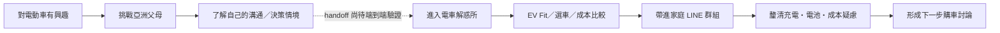
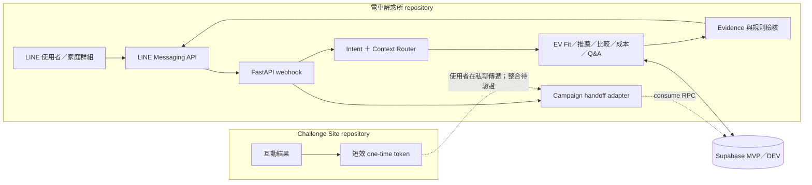

# ⚡ 電車解惑所

> **From EV curiosity to family consensus.**
>
> 從「我想買電動車」，一路陪使用者走到「我們家可以一起討論」。

**挑戰亞洲父母**：讓家庭購車議題有一個願意開始的入口。

**電車解惑所**：讓開始之後的每個疑問，都有辦法繼續談下去。

### 讓「要不要買電動車」從一場家庭爭論，變成可以一起討論的選擇。

「電車解惑所」是 2026 和泰 AI 黑客松的 LINE Bot 競賽 MVP，聚焦 TOYOTA 電動車決策情境。它協助使用者把充電、電池、續航、成本和車款選擇等疑慮，整理成可比較、可查證，也能帶進家庭討論的資訊。

> 本專案是黑客松原型，不是正式商用服務；目前整合與驗證狀態見「MVP Scope & Limitations」。

## 為什麼做「電車解惑所」？

對 EV 有興趣，未必代表家人已經準備好一起換車。討論常從幾個問題開始：「電池壞掉是不是很貴？」「充電會不會很麻煩？」「跑長途怎麼辦？」「真的有比油車省嗎？」「為什麼不直接買油電？」

問題不是查不到資訊，而是資訊散落、難比較，也很難直接轉成「我們家的用車方式適不適合」。因此，電車解惑所把焦點放在家庭共同決策，而不只是回答單題的 EV Chatbot。

## 我們的解法

### 01｜先理解需求

使用者可以用自然語言提問。系統辨識目前談到的主題與目標，並以短期 conversation context 承接追問、車款提及和尚未完成的流程。

### 02｜把問題變成可比較的資訊

透過 EV Fit、車款探索與比較、成本試算及官方資料問答，把抽象疑慮轉成條件、假設、差異和下一步要確認的事。

### 03｜把個人探索帶進家庭討論

Bot 可在家庭 LINE 群組中低干擾地回應 EV 相關問題。每位成員的流程分開承接；FAQ side query 不必取代原本的試算流程；concern board 聚焦待釐清議題，而不是替家人判定立場。

## 使用者旅程

「挑戰亞洲父母」是**另一個 repository、另一套網站系統**。兩個專案共同呈現一條 EV customer journey，但程式與部署各自獨立。圖中的跨站 handoff 是預期旅程；目前 Bot 資料庫 RPC 更新與端到端整合仍未完成驗證。



## 核心體驗

| 功能 | 使用者問題 | 系統如何協助 |
| --- | --- | --- |
| EV Fit | 我適合開電動車嗎？ | 從日常里程、長途、停車與家用／工作地充電條件整理適配因素及待確認事項。 |
| 車款推薦 | 我適合哪台 Toyota？ | 累積使用者明確提供的預算、空間、用途、里程與動力需求，依車款資料整理候選和理由。 |
| 車款比較 | bZ4X 和 RAV4 怎麼選？ | 依可用車款資料結構化比較規格與使用情境，指出目前仍需確認的條件。 |
| 成本試算 | 電車真的比較省嗎？ | 依使用者輸入與明示假設比較能源成本或持有成本；不是報價或節省保證。 |
| EV Q&A | 電池、充電、保固？ | 以可追溯的公開官方知識回答；找不到足夠證據時，不應把猜測當事實。 |
| 家庭群組 | 家人意見不同怎麼辦？ | 低干擾回應 EV 疑慮，維持成員流程隔離，並整理待釐清 concern。 |

測驗 persona 或 quiz 結果**不會決定推薦車款、EV Fit 或個人偏好**。若 handoff 成功，它至多作為短期 conversation starter；推薦仍依使用者在 Bot 中明確提供的條件。

## AI 在這裡不是聊天噱頭

產品把「理解人怎麼問」和「確保答案有依據」分開處理。自然語言分類可使用語意模型作輔助；Gemini 在目前程式中是可選的文案改寫能力，改寫對象是已審核的回覆，不負責決定價格、規格或購車結論。

| 層次 | 負責範圍 |
| --- | --- |
| **AI／Semantic Layer** | 自然語言 intent／goal 理解、追問承接、side query 判斷、語意理解與自然回覆、structured context 輔助。Intent/context routing 由應用中的分類器與流程共同完成；可選 Gemini 僅改寫受控文案。 |
| **Deterministic／Rule Layer** | 金額與 TCO 計算、flow state、車款條件篩選、權限與來源邊界、campaign token 驗證流程。這些行為不交由 LLM 自行決定。 |
| **Evidence Layer** | `vehicle_profiles`、`knowledge_sources`、官方 reference data；內部 organizer aggregate 只供 backend 洞察與產品排序，不作為公開規格或個人化推薦的證據。 |

**AI 負責理解「人怎麼問」；資料與規則負責確保「答案有依據」。** LLM 不得自行捏造價格、保固、政策、殘值或官方規格；相關事實以公開官方來源為準，試算則需揭露輸入與假設。

## 為什麼不是再做一個 EV Chatbot？

一般 Chatbot 是 **User ↔ Bot**；電車解惑所想處理的是 **User ↔ Family ↔ Bot**。家庭對話裡，不只要答對一題，也要避免打斷原本的討論，並保留每位成員自己的探索脈絡。

- **理解群組情境**：依私聊、群組與成員脈絡處理訊息。
- **成員流程分開**：一位成員的成本或 EV Fit 流程不應被另一位成員接手。
- **低干擾介入**：不把每句群組聊天都當成需要回答的提問。
- **承接追問與 side query**：回答相關短問句，同時盡可能保留原本正在進行的流程。
- **整理 concern，不替人貼標籤**：concern board 聚焦議題狀態，不建立「誰支持／反對 EV」的個人結論。

## 從「挑戰亞洲父母」到家庭購車討論

Challenge Site 完成互動後，可建立短效、一次性的 LINE handoff，將使用者帶入 Bot 私聊。Challenge Site repository 與本 repository 分開維護：

[挑戰亞洲父母 — sibling repository](https://github.com/WhiteChocolate0/asian-parents-challenge)

handoff 的安全設計是：raw token 只用於導向／傳遞，不存資料庫；資料庫只保存 SHA-256 hash；token 預期 15 分鐘到期且只能使用一次；handoff 僅限 1 對 1 私聊，group／room 不 consume。**目前資料庫 RPC 尚未套用 canonical error contract，端到端 consume 測試未完成，因此不能宣稱 handoff 已完整可用。** 詳細 contract：[docs/campaign_linebot_integration_contract.md](docs/campaign_linebot_integration_contract.md)。

## Architecture



目前 Supabase project `extkwpghjfttamontqkl` 是 **MVP／DEVELOPMENT DB**，不是正式 Production。shared reference 與既有 Bot state 目前使用 `public`；不為了理想架構在競賽前搬動 state tables。Challenge Site 管理 campaign；Bot 只應透過 handoff RPC 取得必要摘要，不直接查完整 quiz answers 或修改網站 state。

## Data & Evidence

主辦方提供的品牌研究與 CDP 資料，只用於常見疑慮排序、匿名 aggregate insight 與產品設計判斷。raw CDP 不放入 RAG，也不直接提供給使用者；匿名 A 國幣值不是 TWD；年齡、性別等 demographic 不用來做購車推薦。公開規格、價格、保固與政策仍以公開官方資料作為 source of truth。本 README 不公開內部資料內容或下載位置。

## 黑客松提案價值

- **對消費者**：降低理解 EV 資訊與開啟家庭溝通的門檻，從「有疑慮」走到「知道該確認什麼」。
- **對 TOYOTA**：提供一種把對 EV 有興趣、但仍有疑慮的使用者，帶入更具情境產品探索的互動方式。
- **對品牌溝通**：從單向產品資訊，延伸為使用者能在 LINE 中持續追問、比較條件並帶進家庭討論的決策體驗。

以上是提案價值與待驗證方向；目前沒有轉換率、銷量或大規模採用成效數據可供宣稱。

## Demo

可在已設定的 LINE OA 私訊中試問：`我還不確定要不要買電車`、`我怕充電不方便`、`電池保固多久？`、`我適合開電動車嗎？`、`每天 30 公里`、`RAV4 跟 bZ4X 怎麼比較？` 或 `成本試算`。群組測試請使用測試情境，避免貼入個人活動結果。

目前 repository 沒有可安全公開的 QR code 或產品截圖素材。後續可新增至 `docs/images/`：

- `private-menu.png` — 私聊功能入口
- `ev-fit-result.png` — EV Fit 評估結果
- `cost-comparison.png` — 成本比較結果與假設
- `family-group-conversation.png` — 群組低干擾互動與 concern 整理

## Tech Stack

- Python 3.12、FastAPI
- LINE Messaging API、Webhook、Quick Reply、Postback、Flex Message
- Supabase／PostgreSQL
- Vercel Functions
- Gemini（可選；受控文案改寫）與應用端 semantic routing
- pytest、conversation regression harness、FakeRepository

## Reliability & Red Team Testing

測試不只確認函式輸出，也保護對話流程與資料邊界。現有測試程式涵蓋以下風險情境：

- 自然語言流程輸入與 short-query fallback
- context carry-over、entity carry-over 與 flow cancellation
- side query 不意外取代原流程
- 多位群組成員的 flow isolation
- campaign handoff 的私聊限制、token parsing／payload contract
- public RAG 的來源過濾與 internal organizer data boundary

對話回歸 gate 曾有未通過情境；目前 README 不列測試數字，也不代表 P0 gate 已通過。請以最新一次 `make predeploy` 與 readiness 報告判斷展示／部署狀態。Campaign RPC 的 DB integration test 尚未完成。

## MVP Scope & Limitations

- 本專案是 2026 和泰 AI 黑客松 MVP，資料範圍以 TOYOTA／EV 決策情境為主。
- Organizer aggregate 是內部洞察，不等同公開官方統計，也不能替代官方規格。
- TCO 依使用者輸入與模型假設估算，不構成報價、保證或購車建議。
- 車款推薦是 decision support；結果受目前車款資料、明確輸入條件與篩選規則限制，不是購車保證。
- 活動 quiz 結果不決定車款推薦；campaign handoff 的 DB RPC 與端到端流程仍待驗證。
- 正式產品化前仍需進一步完成資安、最小權限、資料治理、使用者研究與可靠性驗證。
- Golden conversation regression gate 應在展示前重跑；既有 readiness 報告不能替代目前程式的最新驗證結果。

## Developer Setup

### Local setup

需求：Python 3.12。一般單元與 conversation tests 使用 FakeRepository／in-memory fixtures，不需要 Supabase 或 Gemini credentials。

```sh
python3 -m venv .venv
.venv/bin/pip install -r requirements.txt
cp .env.development.example .env.development
.venv/bin/python scripts/check_test_environment.py
```

### Environment variables

只在本機 `.env.development` 或 hosting environment 設定必要值。不要把真實 LINE credentials、Supabase service-role key、DB URL 或任何 secrets 寫進 README、範例檔或 Git。環境角色與 Supabase project ref 不一致時，安全檢查必須 fail closed；不可為了跑測試繞過。

### Run

```sh
.venv/bin/uvicorn app.main:app --reload
```

### Tests

```sh
.venv/bin/python -m pytest -q
make test-conversations
make predeploy
```

conversation tests 透過 Fake LINE client、FakeRepository 與測試 fixtures 驅動 `EventProcessor`；DB integration writes 只能使用核准的 MVP／DEV 環境，並在測試後清理。

### Deployment and database changes

部署前先確認最新 regression gate、環境角色及 readiness；不可由本 README 推論「可部署」。SQL／migration 請先讀 [manual migration runbook](docs/manual_migration_runbook.md)，不得對正式資料庫套用未核准變更，也不得將 MVP DB 自動升格為 Production。

## Repository 導覽

| 路徑 | 內容 |
| --- | --- |
| `app/` | FastAPI app、LINE webhook 與 conversation services。 |
| `tests/` | 單元測試、FakeRepository、fixtures 與 conversation scenarios。 |
| `scripts/` | 環境／schema 檢查及離線資料分析工具。 |
| `sql/`、`migrations/`、`supabase/` | SQL package、migration drafts 與歷史 schema；執行前必須先讀 runbook。 |
| `docs/` | integration contract、環境與資料庫 readiness 文件。 |

更多貢獻指引請看 [AGENTS.md](AGENTS.md)。
